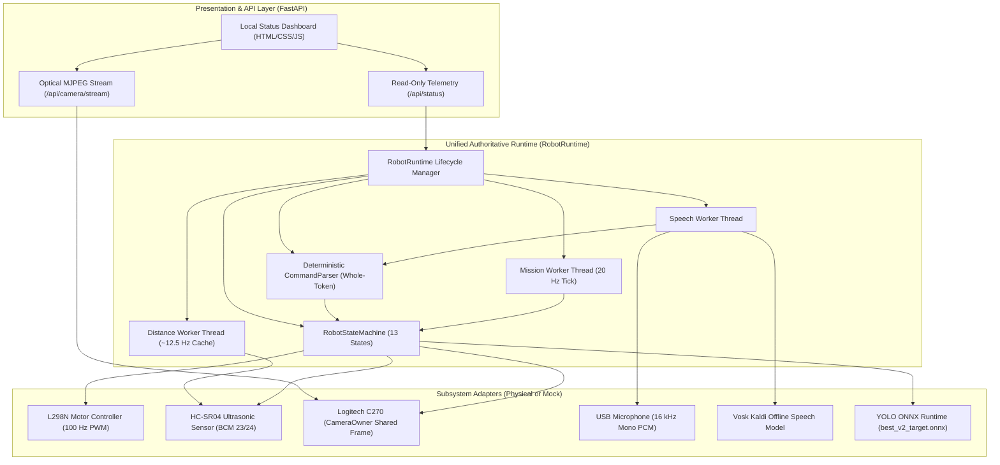

# ARCHITECTURE SPECIFICATION — SS_PROJECT_VCR_FRESH

## 1. System Philosophy & Design Principles

`SS_PROJECT_VCR_FRESH` is an authoritative, clean-room, zero-legacy robotics software stack engineered for the **Raspberry Pi 4 Model B**. It replaces the legacy prototype with a modular, deterministic architecture guided by six fundamental engineering principles:

1. **Hardware-Free Discoverability & Testability:** Every physical subsystem (Motors, Ultrasonic Sensor, Camera, Microphone) is isolated behind an abstract interface protocol (`ABC`). Complete automated testing occurs against deterministic mocks without physical GPIO side effects.
2. **Single Authoritative Resource Owner:** Exactly one software runtime owns physical resources: one Motor Controller, one Ultrasonic Sensor, one Camera grabber, and one Microphone stream. The web dashboard never instantiates duplicate hardware or competing streams.
3. **Deterministic Multi-Layer Safety Hierarchy:** Higher-priority safety interlocks strictly override motion. An Emergency Stop (E-Stop) or obstacle block deterministically clamps all motor speeds to 0.00 immediately.
4. **Token-Level Voice Intent Parsing:** Speech transcripts are parsed using whole-word boundaries and explicit keyword precedence to prevent substring collisions (e.g. "find backpack" must never match "backward").
5. **Read-Only Non-Blocking Telemetry:** The `/api/status` endpoint reads strictly from non-blocking cached state and never triggers ultrasonic sensing pulses or motor actuation.
6. **Fail-Closed Semantics:** Sensor timeouts, dropped camera frames, or unparsed intents default to stopped motors and listening mode.

---

## 2. End-to-End Runtime Architecture

---

## 3. Subsystem Breakdown

### 3.1 Hardware Abstraction Layer (`app/hardware/`)
- **`interfaces.py`**: Declares abstract protocols (`MotorControllerInterface`, `DistanceSensorInterface`, `CameraInterface`, `AudioSourceInterface`, `SpeechRecognizerInterface`, `DetectorInterface`) and immutable domain types (`ObstacleState`, `UltrasonicReading`, `DetectionResult`).
- **`gpio_adapter.py`**: Abstracts Raspberry Pi GPIO via `GPIOAdapter`. In simulation/tests, `FakeGPIOAdapter` records pin states in memory. In real hardware mode, `RPiGPIOAdapter` drives physical BCM GPIO.
- **`motors.py`**: Authoritative `L298NMotorController` with normalized speed inputs $[-1.0, 1.0]$, minimum effective stall speed clamp (`MIN_SPEED`), soft-start acceleration ramping (`SPEED_RAMP_STEP`), and directional pin clamping.
- **`ultrasonic.py`**: Authoritative `HCSR04UltrasonicSensor` with bounded trigger pulses, echo timeout handling ($< 40$ ms), physical blind zone ($< 2.0$ cm) fail-closed critical evaluation, rolling median filtering, and background sampling thread.

### 3.2 Vision Subsystem (`app/vision/`)
- **`camera.py`**: Single `CameraOwner` with a dedicated thread continuously draining the V4L2 kernel frame buffer to eliminate lag. Provides thread-safe copies to both the YOLO detector and the Web UI MJPEG streaming generator.
- **`yolo_detector.py`**: `ONNXYOLODetector` running `best_v2_target.onnx` (input shape `[1, 3, 320, 320]`, output `[1, 30, 2100]` covering 26 classes). Performs letterbox preprocessing, confidence filtering ($\ge 0.35$), multi-class Non-Maximum Suppression (IoU $\ge 0.45$), coordinate rescaling back to $640\times 480$, and optical centering evaluation with deadband ($\pm 40$ px).

### 3.3 Audio & Speech Subsystem (`app/audio/`, `app/command/`)
- **`audio_source.py`**: `PyAudioSource` enumerating USB audio input devices to select the Logitech C270 webcam microphone dynamically. Resamples hardware rates to 16 kHz 16-bit mono PCM chunks.
- **`vosk_recognizer.py`**: Offline speech recognizer utilizing the preserved Kaldi small English model (`vosk-model-small-en-us-0.15`). Operates 100% locally with zero cloud API latency or dependency.
- **`command_parser.py`**: Deterministic token-level voice command parser using regex word boundaries. Enforces token matching to avoid substring collisions (e.g., `"find backpack"` strictly resolves to `SEARCH_TARGET(backpack)` and never collides with `"backward"`).

### 3.4 State Machine & Navigation Engine (`app/navigation/`)
- **`state_machine.py`**: Authoritative 13-state finite state machine coordinating perception, safety interlocks, and motion:
  - `INITIALIZING`: System boot and hardware setup.
  - `IDLE_LISTENING`: Quiescent state awaiting voice or API commands.
  - `MANUAL_MOVEMENT`: Short bounded directional pulses ($0.25$s) gated by forward ultrasonic safety.
  - `SEARCHING`: Bounded sector-by-sector scan ($45^\circ$ turns) with chassis settling delay ($80$ ms) and multi-frame target confirmation before rotation.
  - `TARGET_CONFIRMED`: Target validated over $\ge 2$ consecutive fresh frames.
  - `CENTERING`: Bounded pulse turns optical centering target within horizontal deadband ($\pm 40$ px).
  - `APPROACHING`: Forward bounded pulses ($0.15$s at speed $0.40$) gated by ultrasonic sensor. Stops at `target_stop_distance_cm` ($30$ cm provisional, in the warning band). Never infers physical distance solely from bounding box area!
  - `TARGET_REACHED`: Mission complete; target arrived.
  - `TARGET_NOT_FOUND`: Full $360^\circ$ scan exhausted without detection.
  - `CANCELLED`: Operator cancellation (`"cancel search"`).
  - `BLOCKED`: Forward obstacle detected; motion interlocked.
  - `FAULT`: Hardware failure, sensor timeout, or frame drop.
  - `EMERGENCY_STOP`: Latched stop condition halting all motion and requiring explicit reset.

### 3.5 Unified Runtime & Web Server (`app/runtime.py`, `app/server.py`)
- **`runtime.py`**: Single authoritative `RobotRuntime` coordinating subsystem lifecycles, background worker threads, and read-only non-blocking telemetry snapshots.
- **`server.py`**: FastAPI server exposing local status dashboard, `/api/status`, `/api/command`, `/api/stop`, `/api/emergency-stop`, `/api/clear-estop`, and shared `/api/camera/stream`.

---

## 4. Safety Invariant Rules

1. **Active Low / Zero Output On Startup:** Motors initialize in a disabled, stopped state ($0\%$ PWM, all directional pins LOW).
2. **Latched Emergency Stop:** An E-Stop event cannot be cleared by an ordinary movement command. It requires explicit operator acknowledgement.
3. **Fail-Closed Distance Sensor:** Any sensor timeout, echo loss, or blind-zone reading evaluates to `ObstacleState.CRITICAL` / `FAULT` and blocks all forward motion pulses.
4. **Clean Resource Shutdown:** Signal handlers for `SIGINT` and `SIGTERM` guarantee motors stop, PWM instances release, GPIO cleans up, and threads terminate gracefully.
